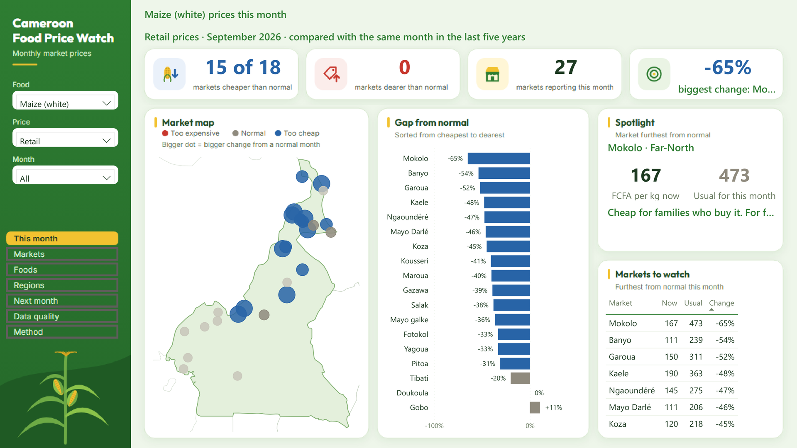

# Cameroon Food Price Watch

Food prices in Cameroon swing sharply, and the families who buy food and the farmers who sell it usually find out too late to react. This project is an automated pipeline that collects World Food Programme prices for 76 markets every month, cleans and tests them, flags prices that are far from normal for the season in both directions, forecasts next month, and shows it all in a Power BI report written for non-technical readers. It found that maize is in a price crash, with 15 of 18 markets well below normal in September 2026, and it caught recording errors in WFP's own data.



| | |
|---|---|
| **Data** | 68,996 WFP price records, Jan 2017 to Sep 2026, 76 markets, 54 foods |
| **Engineering** | Python API ingestion, DuckDB warehouse, dbt models, 24 data checks, monthly GitHub Actions run |
| **Science** | Seasonal anomaly detection, gradient-boosted forecast with walk-forward backtest |
| **Report** | Seven-page Power BI report built as a PBIP project from code |
| **Tests** | 21 code tests and 24 data checks, all passing |

## The question

Can public market data warn people early when a food price is unusually high or unusually low for the time of year, and can next month's price be predicted well enough to help?

Some rise every year is normal: prices climb in the lean season before the harvest. So the real question for each price is narrower: **is this market's price far from what it usually is in this month?**

## The data

[WFP food prices for Cameroon](https://data.humdata.org/dataset/wfp-food-prices-for-cameroon), published by the World Food Programme on the Humanitarian Data Exchange (HDX), licence CC BY-IGO. The pipeline reads it through [HDX HAPI](https://hapi.humdata.org/docs), HDX's official API for programs.

- 68,996 price records, January 2017 to September 2026 (HAPI's coverage; the HDX file goes back to 2005)
- 76 markets in 9 regions, 54 foods, retail and wholesale, in FCFA
- Many pack sizes: maize alone is priced per kg and per 15, 18, 90 and 100 kg bag

Limits of the data:
- WFP is collecting less: about 16,000 prices in 2023, about 4,000 in the first nine months of 2026.
- Only 29 of 76 markets reported in September 2026. Limbé reported for 77 months, then stopped after December 2025, as did Tiko, Mutengene and Muea.
- Many markets in the Centre, Littoral and South-West have only a few years of history.

## The method

```
HDX HAPI ──> 1. Fetch ──> 2. Clean and store ──> 3. Alerts ──> 4. Forecast ──> 5. Export ──> Power BI
            (Python)      (dbt + DuckDB)         (dbt)          (scikit-learn)   (CSV)
                          GitHub Actions runs all of it on the 10th of each month
```

**1. Fetch** (`src/ingest/fetch_wfp.py`). Downloads prices from HAPI in pages of 2,000 rows and retries pages that arrive cut off. After the first full download it re-fetches only the last six months, because WFP sometimes corrects recent prices, and merges them in. Each run is recorded in `data/raw/manifest.json` with row counts and a SHA-256 fingerprint; if nothing changed, nothing is saved. The HDX file link blocks scripts with a bot check, so the pipeline uses HAPI, HDX's supported route.

**2. Clean and store** (`transform/`, dbt on DuckDB). In Maroua in September 2024, maize was 350 FCFA per kg retail and 35,000 per 100 kg bag: the same price. The staging model reads the pack size from the unit and converts every price to FCFA per kg (per litre for oil, per piece for eggs). Prices more than 3 times above or below the national median for that food and month are flagged as suspect and kept out of the alerts. Twenty-four data checks run on every build and stop the monthly job if one fails.

| Table | What's in it |
|---|---|
| `stg_wfp__prices` | Every raw price converted to a standard unit |
| `fct_monthly_prices` | One price per market, food, price type and month, with the national median and a suspect flag |
| `fct_price_alerts` | Each price against its seasonal normal, with an alert level |
| `dim_markets` | Each market's location, first and last month, coverage and whether it still reports |

**3. Seasonal alerts** (`fct_price_alerts`). Each price is compared with the median for the same market, food, price type and calendar month in the previous five years, using earlier years only, so an alert knows only what someone would have known at the time. 20% from normal is a watch, 40% is an alert, upwards and downwards. A market needs three earlier years for that month before it's judged. Two tests guard the logic, including one that proves no same-year or future data is used.

**4. Forecast** (`src/forecast/forecast_prices.py`). A gradient-boosted tree model (scikit-learn) predicts next month's price for every market, food and price type, using recent moves, last year's move, the national trend, the month, the food and the region. It was tested month by month over October 2025 to September 2026, each time trained only on data from before the month it predicted, and compared with two simple guesses. Its forecast is published as a likely range taken from its own past errors.

**5. Report** (`powerbi/`). A seven-page Power BI report generated by `powerbi/build/build_pbip.py`: a data model with about 100 DAX measures, a Green Sidebar design, and three colours that are safe for colour-blind readers (red = too expensive, grey = normal, blue = too cheap).

## What I found

**Maize is in a price crash.** In September 2026, 15 of 18 markets with enough history sold maize well below normal and none above. Mokolo was 65% below its usual September price, Garoua 52% and Maroua 40%. Red and white sorghum fell with it; yam, potatoes and dried fish went up. Good news for families who buy maize, hard for farmers selling below what seed and fertiliser cost.

**The alerts catch what really happened.** Retail white maize in Maroua:

| Month | Price | Normal | Gap | Level |
|---|---|---|---|---|
| June 2024 (lean season) | 563 | 342 | +65% | alert high |
| February 2026 (price crash) | 134 | 350 | −62% | alert low |
| September 2026 | 200 | 334 | −40% | alert low |

Across maize, imported rice and fresh cassava, high alerts cluster in 2022 to 2024, when food inflation was high; in 2026 it flips to 80 low alerts against 2 high.

**Forecasting one month ahead is hard, and the model says so.** Over 5,136 test predictions:

| Method | Typical error | Within 10% | Direction right when the price moved over 10% |
|---|---|---|---|
| Next month = this month | 3.2% | 69% | (never predicts a move) |
| Copy last year's move | 5.6% | 63% | 29% |
| Gradient-boosted model | 3.4% | 70% | 58% |

The model is no more accurate than assuming the price stays the same, because 35% of prices don't change from one month to the next. Where it helps is direction: when prices really moved, it called up or down right 58% of the time. That's why the report shows a likely range (about 14% below to 18% above the estimate) and never one exact number.

**The source data has errors, and the checks found them.** In September 2023 many markets jump 3 to 10 times and drop back the next month, most likely a recording error. In April 2024 several Yaoundé and Douala markets list fresh cassava at up to 6,400 FCFA "per kg", which are bag prices entered as kg. In all, 1,052 prices (1.5%) are flagged and left out of the alerts and forecasts.

## Limitations

- "Normal" isn't adjusted for general inflation yet. Deflating prices with Cameroon's consumer price index is the next improvement.
- 78% of prices can't be judged yet, because markets need three years of history for that month.
- The suspect-price check compares markets within the same month, so it misses an error that hits every market at once, like September 2023. Comparing each price with the same market's previous month would catch it.
- One month is a short horizon. A longer horizon, or adding rainfall and exchange-rate data, may help the forecast.
- WFP's shrinking coverage means some months and markets have gaps.

## The report

| Page | What it answers |
|---|---|
| 1. This month | Is anything wrong with prices right now? KPI cards, market map, gap by market, spotlight, markets to watch |
| 2. Markets | What's happening in one market over time, against its usual price |
| 3. Foods | Which foods are cheaper or dearer than normal across markets |
| 4. Regions | Which regions are furthest from normal |
| 5. Next month | Likely price range for each market, and expected alerts |
| 6. Data quality | Suspect prices, coverage, and known problems in the source data |
| 7. Method | How it works and its limits, in plain words |

Screenshots of every page are in `docs/screenshots/`. A 1 min 41 s video tour of the report, with captions, is [`docs/walkthrough.mp4`](docs/walkthrough.mp4). A walkthrough of the engineering and science work, with outputs, is in `docs/behind-the-dashboard.html`.

## Reproduce it

Requires Python 3.10 or later.

```bash
python -m venv .venv
source .venv/bin/activate                     # Windows: .venv\Scripts\activate
pip install -r requirements.txt -r requirements-dev.txt

# HAPI asks each app to identify itself: base64 of "app_name:email"
export HAPI_APP_IDENTIFIER=$(printf 'your-app-name:you@example.com' | base64)

python -m pytest -q                                          # 21 code tests
python -m src.ingest.fetch_wfp --full                        # 1. fetch the whole history
dbt build --project-dir transform --profiles-dir transform   # 2-3. warehouse, alerts, 24 data checks
python -m src.forecast.forecast_prices                       # 4. backtest and forecast
python -m src.export.export_powerbi                          # 5. tables for Power BI
python powerbi/build/build_pbip.py                           # build the Power BI project
```

Open `powerbi/Cameroon Food Price Watch.pbip` in Power BI Desktop. If your copy of the repository is in a different folder, change the `DataFolder` parameter (Transform data > Edit parameters) to your `powerbi/data/` folder, then refresh.

For the monthly run on GitHub, add the repository secret `HAPI_APP_IDENTIFIER`.

## Repository structure

```
src/ingest/fetch_wfp.py          fetch from HDX HAPI
transform/                       dbt project: models and data tests
src/forecast/forecast_prices.py  forecast and backtest
src/export/export_powerbi.py     CSV tables for Power BI
powerbi/                         Power BI project, its data, and the code that builds it
data/raw/                        downloaded prices and the fetch manifest
data/outputs/                    next month's forecast
reports/forecast_backtest.json   every forecast score
tests/                           code tests
docs/                            walkthrough and screenshots
.github/workflows/               the monthly run
```

## Sources

- World Food Programme, Cameroon food prices, via [HDX HAPI](https://hapi.humdata.org) (CC BY-IGO).
- [WFP DataViz](https://dataviz.vam.wfp.org/western-africa/cameroon/economic/prices), the official price dashboard (with its ALPS spike alert). This project complements it with low-price alerts, a tested forecast range and data-quality flags.
- Inspiration only, no code reused: [osulayman/nigeria-food-price-analysis](https://github.com/osulayman/nigeria-food-price-analysis).

## Tech stack

Python · HDX HAPI · DuckDB · dbt · pandas · scikit-learn · pytest · GitHub Actions · Power BI (PBIP, DAX)

Built by [Bih Brandy Sango](https://github.com/bihbrandysango-cloud).

## Licence

Code: MIT, see [LICENSE](LICENSE). Data: World Food Programme via HDX, CC BY-IGO.
